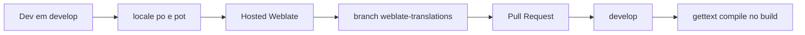
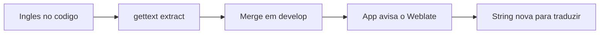
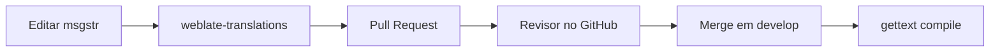

# Weblate no Hosted Weblate — RER-DPG

Este documento descreve como usar o [Hosted Weblate](https://hosted.weblate.org/) (plano **Libre**, grátis) no repositório [Rural-Environmental-Registry/core](https://github.com/Rural-Environmental-Registry/core), com envio de traduções via **Pull Request** para a branch **`develop`**.

Para convenções de gettext, estrutura de `locale/` e papéis de desenvolvedor/tradutor, consulte [i18n-gettext.md](./i18n-gettext.md).

O Weblate **não entra** no Docker da aplicação e **não altera** `gettext:extract` nem `gettext:compile`. A integração é conta, GitHub App e dois componentes.

## Visão geral

1. O desenvolvedor escreve inglês no código, roda `gettext:extract` e faz merge em `develop`.
2. O Hosted Weblate **lê** `locale/**/*.po` e `*.pot` nessa branch.
3. O tradutor edita só `msgstr` de `pt-br` e `es-es`.
4. O Weblate grava no branch `weblate-translations` e **abre um Pull Request** para `develop`. Ninguém faz push direto em `develop`.
5. Depois do merge, o build local ou o CI compila os `.po`.

Arquivos **gerados** (`locale/frontend/translations.json`, `frontend/src/i18n/translations.json`, `backend/src/main/resources/reports/i18n/**/report_params.json`) ficam fora da máscara de arquivos. São produzidos no build, depois do merge.



## Plano Libre

O repositório é público e está sob GPL-3. O plano escolhido é o **Libre** do Hosted Weblate.

| Item | Valor |
|------|--------|
| Plano | Libre (grátis), só para projeto público, com aprovação do Weblate |
| Strings hospedadas | até 160 mil (cada string-fonte conta de novo em cada idioma) |
| Projetos | 1 |
| Componentes e idiomas | ilimitados |
| Serviço | [hosted.weblate.org](https://hosted.weblate.org/) |

Condições do plano, conforme o [site do Weblate](https://weblate.org/en/hosting/):

- Código-fonte público, com licença livre, e traduções no mesmo repositório.
- Há um período de teste; para continuar grátis é preciso pedir a aprovação do Weblate.
- O README do repositório deve citar que as traduções usam o Weblate.
- O plano comum **não** oferece domínio próprio nem SSO. Isso fica na instância dedicada, que não é este guia.

Os textos de interface e de recibo ficam também nos servidores do Weblate (nuvem na UE). O conteúdo dos `.po` já é público no GitHub. Se o repositório deixar de ser público, o Libre deixa de servir.

## Pré-requisitos

| Item | Valor |
|------|--------|
| Organização / repo | `Rural-Environmental-Registry/core` |
| URL | `https://github.com/Rural-Environmental-Registry/core` |
| Branch de leitura | `develop` |
| Branch de push | `weblate-translations` |
| Branch alvo do PR | `develop` |
| Pasta de traduções | `locale/` na raiz do monorepo |

Não versionar token, senha ou URL com credencial. O app do GitHub autentica clone, push, abertura de PR e aviso de push. Não é preciso webhook separado nem token no repositório.

## Conta e GitHub App

1. Criar conta em [hosted.weblate.org](https://hosted.weblate.org/) e escolher o plano Libre.
2. No workspace do Weblate, usar **Connect GitHub account**.
3. Instalar o app [Hosted Weblate](https://github.com/apps/hosted-weblate) **somente** no repositório `core` da organização `Rural-Environmental-Registry`.
4. Importar os componentes pelo fluxo do app. O controle de versão fica **GitHub (via Weblate GitHub app)**, não Git puro. A URL do repositório fica somente leitura, para o app não ser redirecionado a outro remoto.

Sem **Push branch**, o Weblate abre um fork. Com `weblate-translations`, o commit vai para esse branch no repositório de origem e o PR aponta para `develop`.

## Configuração do projeto

### 1. Criar o projeto

| Campo | Valor |
|-------|--------|
| Nome | `RER-DPG` |
| Slug | `rer-dpg` |
| Site web do projeto | `https://github.com/Rural-Environmental-Registry/core` |
| Language aliases | `en-us:en,pt-br:pt_BR,es-es:es` |

Os aliases são sensíveis a maiúsculas e devem repetir o código que aparece no nome do arquivo (hífen), mapeado para o código de idioma do Weblate.

### 2. Componentes

Criar **dois** componentes, ambos lendo `develop` e gravando em `weblate-translations`.

Campos comuns:

| Campo | Valor |
|-------|--------|
| Version control system | GitHub (via Weblate GitHub app) |
| Repository branch | `develop` |
| Push branch | `weblate-translations` |
| Formato de arquivo | GNU gettext PO (monolingual) |
| Edit base file | desligado |
| Manage strings | desligado |

**Edit base file** e **Manage strings** ficam desligados para o tradutor não alterar `en-us.po`, `msgid` nem `msgctxt`.

Título sugerido do PR: `i18n: atualização de traduções via Weblate`.

#### Componente `frontend-ui`

| Campo | Valor |
|-------|--------|
| Nome | `frontend-ui` |
| Máscara de arquivos | `locale/frontend/*.po` |
| Monolingual base language file | `locale/frontend/messages.pot` |

Arquivos versionados:

- `locale/frontend/en-us.po`
- `locale/frontend/pt-br.po`
- `locale/frontend/es-es.po`
- `locale/frontend/messages.pot` (somente leitura para tradutores; atualizado por desenvolvedores via `gettext:extract`)

#### Componente `backend-reports`

| Campo | Valor |
|-------|--------|
| Nome | `backend-reports` |
| Máscara de arquivos | `locale/backend/*.po` |
| Monolingual base language file | `locale/backend/reports.pot` |

Arquivos versionados:

- `locale/backend/en-us.po`
- `locale/backend/pt-br.po`
- `locale/backend/es-es.po`

Para relatórios Jasper, tradutores editam `msgstr`. O `msgctxt` (ex.: `header.title_text`) identifica a chave na estrutura JSON e não deve ser alterado.

### 3. Sincronização com `locale/LINGUAS`

O arquivo [`locale/LINGUAS`](../../locale/LINGUAS) define os idiomas suportados:

```
en-us
pt-br
es-es
```

Manter os códigos de arquivo `.po` alinhados a essa lista. Ao adicionar idioma novo:

1. Atualizar `locale/LINGUAS` e o código (ver [i18n-gettext.md](./i18n-gettext.md)).
2. Incluir o alias `codigo-do-arquivo:codigo_Weblate` no projeto.
3. Adicionar o idioma nos dois componentes.
4. Copiar do `.pot` correspondente o novo `{locale}.po`.

### 4. Arquivos que o Weblate não deve editar

Não incluir na máscara:

| Caminho | Motivo |
|---------|--------|
| `locale/frontend/translations.json` | Gerado por `npm run gettext:compile` |
| `frontend/src/i18n/translations.json` | Cópia de runtime do compile |
| `backend/src/main/resources/reports/i18n/**` | Gerado por `compile-backend-reports` / Gradle |
| `frontend/src/i18n/legacyKeyMap.ts` | Código-fonte; msgid vem do extract |

## Papéis e responsabilidades

### Desenvolvedores (repositório core)

1. Escrever strings em **inglês** no código (`$gettext('...')`).
2. Rodar `cd frontend && npm run gettext:extract` após mudanças de UI.
3. Commitar e fazer merge em `develop`: `.pot`, `.po` (novas entradas com `msgstr` vazio nas traduções).
4. Revisar e aprovar PRs abertos pelo Weblate.
5. Após merge do PR de tradução, validar localmente:

```bash
cd frontend && npm run gettext:compile && npm run build
node scripts/i18n/compile-backend-reports.mjs   # se alterou backend PO
```

### Tradutores (Weblate)

1. Acessar `https://hosted.weblate.org/projects/rer-dpg/`.
2. Editar **somente** `msgstr` em `pt-br` e `es-es` (e futuros idiomas).
3. Marcar a tradução como revisada no Weblate, conforme o fluxo interno.
4. Deixar o Weblate **enviar** (criar o PR). Não clonar o repositório para editar `.po` à mão, salvo exceção combinada.

### Revisores de PR (GitHub)

1. Verificar que o PR contém **apenas** alterações em `locale/**/*.po` (e, se o Weblate sincronizou metadados, `messages.pot` ou `reports.pot`).
2. Rejeitar PRs que alterem `translations.json` ou código-fonte.
3. Fazer merge em `develop` quando as traduções estiverem corretas.

## Fluxos de trabalho

### A — Nova string na aplicação (desenvolvedor)



### B — Tradução e integração (tradutor → PR)



### C — Conflito entre extract e Weblate

O merge do desenvolvedor em `develop` vem primeiro. O app avisa o Weblate, que puxa de novo e marca entradas `fuzzy`.

| Situação | Ação |
|----------|------|
| Dev alterou `.pot` e tradutor o mesmo `.po` | Merge do dev em `develop` primeiro; Weblate refaz o pull e pede retradução das entradas `fuzzy` |
| PR do Weblate com conflito em `.po` | Resolver no GitHub ou no Weblate; não apagar `msgid` |
| String removida do código | `gettext:extract` marca a entrada obsoleta no `.po`; o Weblate limpa na próxima sincronização |

## Proteção de `develop` no GitHub

- Exigir Pull Request antes do merge.
- Exigir pelo menos um revisor (code owners em `locale/`, se a organização usar).
- A instalação do app **não** recebe bypass de merge.

### Modelo de descrição do PR

```markdown
## Traduções Weblate

Atualização de arquivos PO em `locale/frontend` e/ou `locale/backend`.

### Checklist do revisor
- [ ] Apenas arquivos `.po` (sem JSON gerado)
- [ ] `msgstr` coerente com `msgid` em inglês
- [ ] Sem alteração de `msgctxt` nos PO de relatório
- [ ] Após merge: `gettext:compile` no pipeline ou validação local
```

## Pós-merge: validação no repositório

```bash
git checkout develop && git pull

# Frontend
cd frontend
npm ci
npm run gettext:compile
npm run build

# Backend (se houve mudança em locale/backend)
cd ..
node scripts/i18n/compile-backend-reports.mjs
cd backend && ./gradlew compileJava -x test
```

Confirmar na aplicação os idiomas `pt-br` e `es-es` (seletor de idioma / `localStorage` chave `language`).

## O que não fazer

- Não versionar token, senha ou URL com credencial.
- Não incluir `translations.json` nem `reports/i18n/**` na máscara.
- Não apontar o Weblate para outro remoto que não seja `Rural-Environmental-Registry/core`.
- Não usar Git puro, token pessoal nem o usuário `weblate` de SSH no lugar do app.
- Não configurar webhook separado: o app já avisa o Weblate a cada push.
- Não dar à instalação do app permissão de merge sem revisão.

## Checklist de implantação

| # | Etapa | Responsável |
|---|--------|-------------|
| 1 | Criar conta no Hosted Weblate e selecionar o plano Libre | Gestão i18n |
| 2 | Conectar a conta GitHub e instalar o app só no repositório `core` | DevOps |
| 3 | Criar o projeto `RER-DPG` (`rer-dpg`) e os aliases de idioma | i18n / Dev |
| 4 | Importar `frontend-ui` e `backend-reports` a partir de `develop`, com push em `weblate-translations` | i18n / Dev |
| 5 | Proteger `develop`: PR obrigatório, pelo menos um revisor, sem bypass para o app | DevOps |
| 6 | Citar o Weblate no README e pedir a aprovação do plano Libre | Gestão i18n |
| 7 | Cadastrar tradutores com contas individuais | Gestão i18n |
| 8 | Provar o ciclo: traduzir uma string, conferir que o PR só mexe em `locale/**/*.po`, fazer merge e compilar | Dev + tradutor |

## Referências

- Repositório RER: [github.com/Rural-Environmental-Registry/core](https://github.com/Rural-Environmental-Registry/core)
- Gettext no projeto: [i18n-gettext.md](./i18n-gettext.md)
- Hosted Weblate: [hosted.weblate.org](https://hosted.weblate.org/)
- Plano Libre: [weblate.org/en/hosting](https://weblate.org/en/hosting/)
- App no GitHub: [github.com/apps/hosted-weblate](https://github.com/apps/hosted-weblate)
- Integração com GitHub: [Code-hosting integrations](https://docs.weblate.org/en/latest/admin/code-hosting.html)
- Projetos e aliases: [Translation projects](https://docs.weblate.org/en/latest/admin/projects.html)
